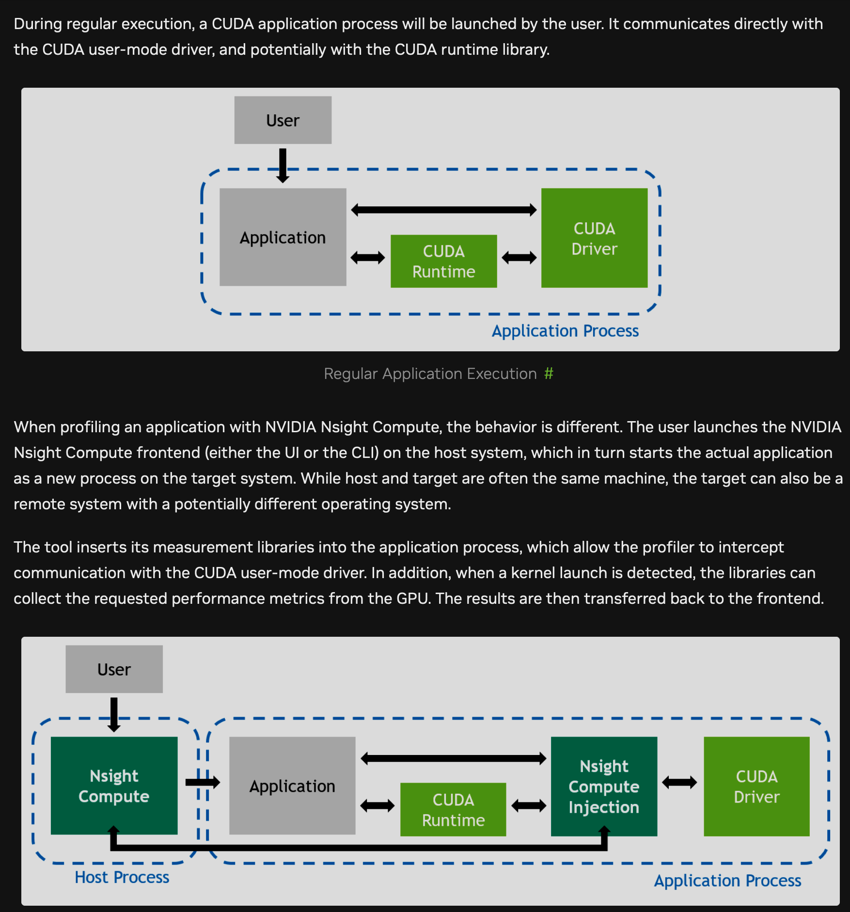
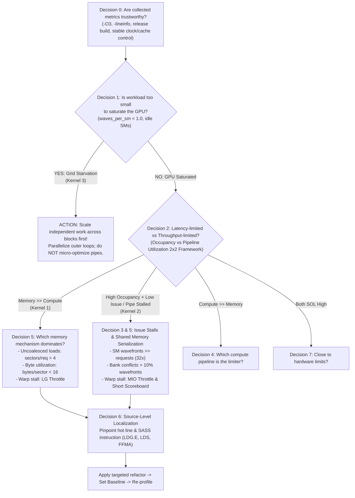

# Lecture 14: CUDA Performance Triage Lab with Nsight Compute



This lab implements a hands-on performance debugging curriculum based directly on the **[NVIDIA Nsight Compute Compute Triage Guide](https://docs.nvidia.com/nsight-compute/ComputeTriage/index.html)** and Chapter 7 (*Reading the Profiler*).

To make learning straightforward, each exercise provides **two separate, minimal CUDA C++ files** (a sabotaged version and a fixed version):
- [`kernel1_sabotaged.cu`](kernel1_sabotaged.cu) & [`kernel1_fixed.cu`](kernel1_fixed.cu)
- [`kernel2_sabotaged.cu`](kernel2_sabotaged.cu) & [`kernel2_fixed.cu`](kernel2_fixed.cu)
- [`kernel3_sabotaged.cu`](kernel3_sabotaged.cu) & [`kernel3_fixed.cu`](kernel3_fixed.cu)

Students profile the sabotaged kernel, identify the root cause using the official triage decision tree, profile the fixed kernel, and use Nsight Compute's **Set Baseline** feature to measure the exact differences.


## NVIDIA Triage Decision Flowchart



---

## Summary of the Three Sabotaged Kernels

| Exercise | Sabotaged vs Fixed | NVIDIA Triage Decision | Root Cause | Primary Profiler Signatures |
| :--- | :--- | :--- | :--- | :--- |
| **Exercise 1** | [`kernel1_sabotaged.cu`](kernel1_sabotaged.cu)<br>[`kernel1_fixed.cu`](kernel1_fixed.cu) | **Decision 2 $\rightarrow$ Decision 5 $\rightarrow$ Decision 6** (Memory-Heavy) | Uncoalesced global memory loads (thread index mapped across rows) | • Memory SOL > 90% (L1TEX) vs Compute SOL < 6%<br>• `sectors/request` ~16.5–32 (ideal 4)<br>• `bytes/sector` = 4.0 B (12.5% efficiency)<br>• Stall: `LG Throttle` (>85% of warp stalls) |
| **Exercise 2** | [`kernel2_sabotaged.cu`](kernel2_sabotaged.cu)<br>[`kernel2_fixed.cu`](kernel2_fixed.cu) | **Decision 2 $\rightarrow$ Decision 3/5 $\rightarrow$ Decision 6** (Shared Memory Serialization) | 32-way shared memory bank conflicts (unpadded `tile[32][32]`) | • High occupancy (>80%) + low issue rate (<0.2)<br>• `Shared wavefronts/request` = 32 (ideal 1)<br>• Millions of bank conflicts in shared memory<br>• Stall: `MIO Throttle` & `Short Scoreboard` |
| **Exercise 3** | [`kernel3_sabotaged.cu`](kernel3_sabotaged.cu)<br>[`kernel3_fixed.cu`](kernel3_fixed.cu) | **Decision 1** (Under-saturated Workload) | Grid starvation (only 4 blocks launched for entire GPU) | • `launch__waves_per_multiprocessor` = 0.030 $\ll 1.0$<br>• `sm__cycles_active.min == 0` (>95% idle SMs)<br>• Both SOL bars $< 10\%$<br>• Action: Scale independent work across blocks first! |

---

## Building and Profiling

Compile all targets with the included [`Makefile`](Makefile):
```bash
# Build all 6 binaries with -O3 -lineinfo (default: sm_90, override via ARCH=sm_80, sm_89, etc.)
make ARCH=sm_90
```

### Exercise 1: Uncoalesced Global Memory Access

```bash
# Profile sabotaged and fixed runs
make profile-k1

# Or run manual ncu commands:
ncu --set full --import-source yes --clock-control none --cache-control none -f -o k1_sabotaged ./kernel1_sabotaged
ncu --set full --import-source yes --clock-control none --cache-control none -f -o k1_fixed ./kernel1_fixed
```

**Triage Walkthrough**:
1. In `k1_sabotaged`, Speed of Light shows **Memory Throughput > 95%** while **Compute is < 6%**.
2. Following **Decision 5**, inspect Memory Workload Analysis: `sectors/request` is ~16.5 to 32 (exceeds 4), and `bytes/sector` is only 4.0 bytes.
3. In Warp State Statistics, warps spend >85% of cycles waiting in `Stall LG Throttle`.
4. In `kernel1_fixed.cu`, `threadIdx.x` is remapped to columns (`stride = 1`). In NCU GUI, set `k1_sabotaged` as **Baseline**:
   - Duration drops by **~92%** (12.5x speedup).
   - Sectors per request drops from 16.5 to **2.5** (-85%).
   - `Stall LG Throttle` drops by **-97%**.

---

### Exercise 2: Shared Memory Bank Conflicts

```bash
# Profile sabotaged and fixed runs
make profile-k2

# Or run manual ncu commands:
ncu --set full --import-source yes --clock-control none --cache-control none -f -o k2_sabotaged ./kernel2_sabotaged
ncu --set full --import-source yes --clock-control none --cache-control none -f -o k2_fixed ./kernel2_fixed
```

**Triage Walkthrough**:
1. In `k2_sabotaged`, global loads and stores are 100% coalesced, yet duration is slow.
2. In **Decision 2**, check the 2x2 matrix: high occupancy + low issue rate $\rightarrow$ **Latency-limited / Pipeline Stalled**.
3. In **Decision 3 & 5**, inspect Warp State Statistics: dominated by `Stall MIO Throttle` (shared memory pipe).
4. Inspect the Shared Memory Table: `shared memory wavefronts per request` is **32** (every warp request is replayed 32 times due to Bank 0 collisions).
5. In `kernel2_fixed.cu`, the tile is padded to `tile[32][33]`. Compare with baseline:
   - Bank conflicts drop from millions to **0** (-100%).
   - Shared memory wavefronts drop from 32 to **1** (-97%).
   - `MIO Throttle` collapses; kernel achieves a **~3x–5x speedup**.

---

### Exercise 3: Grid Starvation & Workload Imbalance

```bash
# Profile sabotaged and fixed runs
make profile-k3

# Or run manual ncu commands:
ncu --set full --import-source yes --clock-control none --cache-control none -f -o k3_sabotaged ./kernel3_sabotaged
ncu --set full --import-source yes --clock-control none --cache-control none -f -o k3_fixed ./kernel3_fixed
```

**Triage Walkthrough**:
1. Following **Decision 1: Is the workload too small to saturate the GPU?**:
   - `launch__waves_per_multiprocessor` = $4 / 132 \approx \mathbf{0.030\text{ waves}} \ll 1.0$.
   - Workload Distribution shows `sm__cycles_active.min == 0`: 128 of 132 SMs did zero work!
   - Both Speed of Light bars are $< 10\%$.
2. NVIDIA Triage Rule: **Do NOT micro-optimize instructions or memory when the grid is starved. Scale independent work across blocks first!**
3. In `kernel3_fixed.cu`, the launch is scaled to 65,536 blocks (`grid((N + 256 - 1) / 256)`). Compare with baseline:
   - Waves per multiprocessor jumps to ~496 waves.
   - `sm__cycles_active.min > 0` (all SMs balanced).
   - Compute Throughput jumps from ~3% to **>70%**.
   - Execution time drops by **>25x**.

## Metrics:

* `l1tex__t_sectors_pipe_lsu_mem_global_op_ld.sum` 
* `l1tex__t_requests_pipe_lsu_mem_global_op_ld.sum`
* `l1tex__t_sectors_pipe_lsu_mem_global_op_st.sum` 
* `l1tex__t_requests_pipe_lsu_mem_global_op_st.sum`
* `l1tex__data_bank_conflicts_pipe_lsu_mem_shared_op_ld.sum`
* `l1tex__data_bank_conflicts_pipe_lsu_mem_shared_op_st.sum`