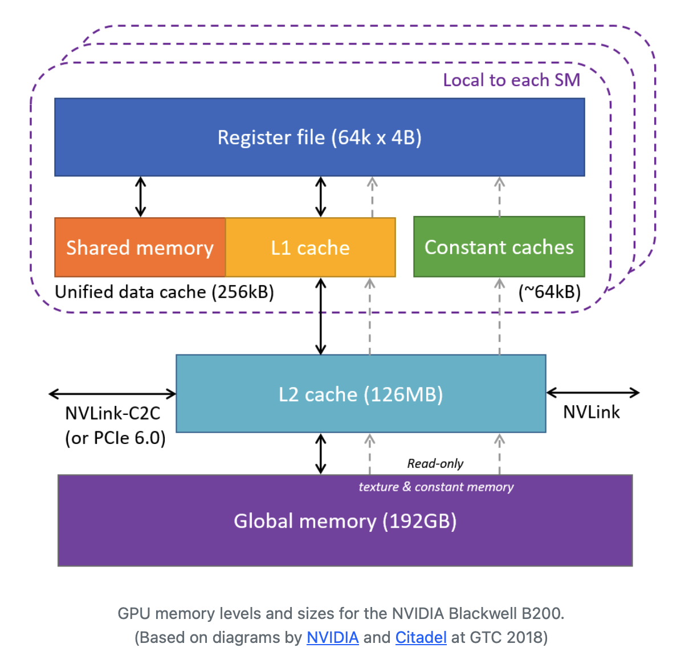
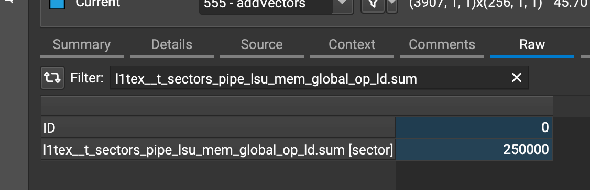
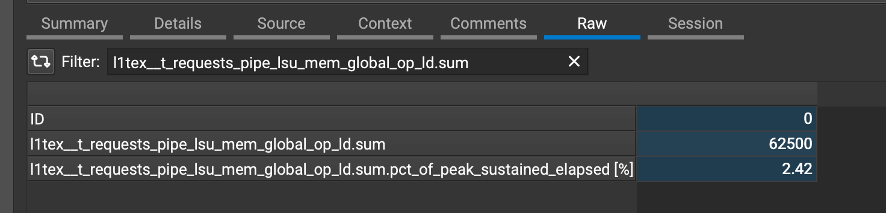
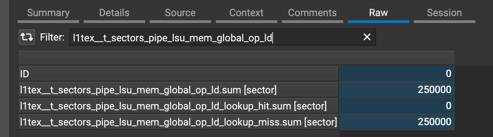
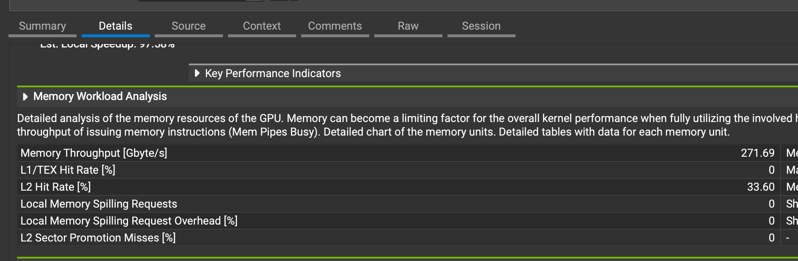

# 03. Optimizing a Kernel for Matrix Transposition

- [03. Optimizing a Kernel for Matrix Transposition](#03-optimizing-a-kernel-for-matrix-transposition)
  - [Memory Hierarchy in GPUs](#memory-hierarchy-in-gpus)
  - [Global Memory Coalescing](#global-memory-coalescing)
  - [Profiling with Nsight Compute](#profiling-with-nsight-compute)
    - [Checking Global Memory Access Efficiency](#checking-global-memory-access-efficiency)
    - [Checking Bank Conflicts](#checking-bank-conflicts)
  - [Kernel 1: Matrix Transpose](#kernel-1-matrix-transpose)
  - [Kernel 2: Improve Global Memory Coalescing with Shared Memory](#kernel-2-improve-global-memory-coalescing-with-shared-memory)
  - [Kernel 3: Reduce Shared Memory Bank Conflicts](#kernel-3-reduce-shared-memory-bank-conflicts)
  - [References](#references)

## Memory Hierarchy in GPUs

To ensure memory operations are cheaper, GPUs, just like CPUs, adopt a multi-tier memory access model. The smallest and closest memory available to a CUDA thread are the registers. Registers are local to each thread in the CUDA core.

All threads within the thread-block can access the shared memory present within the streaming multiprocessor (SM). The access to global memory is through the L1 and L2 caches. The **L1 cache** is local to the SM whereas the **L2 cache** is shared amongst all SMs.

The L1 cache and the SM shared memory share the same data space, of size 128KB to 256 KB depending on the GPU architecture or variant.

The L1 cache line is 128-byte and is divided into 4 **sectors** each 32-byte wide.

> [!NOTE]
> ***Cache size*** refers to the capacity or amount of information that the cache can store. ***Cache line*** refers to the size of the smallest data-unit that can be transferred to/from the cache.

The 4 sectors can be independently loaded or evicted, hence allowing 4 independent accesses to the L1 cache. 

If the memory value to be accessed is not found in the L1 cache, a search is made in the L2 cache. If the value is found in the L2 cache, it is loaded in the L1 cache.

In the other case, if the value was not found in the L2 cache, the global memory or GPU's DRAM will be accessed. The value will then be cached in the L2 and L1 caches.



## Global Memory Coalescing

A thread-block is mapped to a streaming multiprocessor for execution. A single SM executes a single thread block at any given moment.

A SM will *fetch, decode and execute* a group of 32 threads together taken from a thread block. This group of 32 threads that execute in unison are called a *warp*. Threads within a warp execute the same instruction for a given clock cycle. This cooperation among the threads in a warp is an example of the SIMT (Single Instruction, Multiple Threads) execution model. The warp is the smallest unit of execution on a GPU.

The order of execution of warps on a SM is not deterministic and multiple warp may execute simultaneously on a SM. As threads within a warp execute the same instruction, they will read/write to global memory together. Instead of serving memory requests for individual threads, the GPU will be attempt to coalesce all memory requests accessing continuous locations into a single memory transaction.

> [!NOTE]
> Why are memory transactions accessing continuous locations coalesced? 
>
> Accessing the global memory (GPU DRAM) is an expensive operation, similar to CPUs. To reduce the cost of this operation, we introduce multi-tier caches

But how are 32 threads grouped in warps? We do have a `%warpid` special register that holds the ID of the warp in which the current thread is present. 


## Profiling with Nsight Compute

Download [Nsight Compute](https://developer.nvidia.com/tools-overview/nsight-compute/get-started#latest).


```bash
nvcc vecadd.cu -o vecadd
ncu --set full -f -o vecadd_profil e.ncu-rep ./vecadd
```


```bash
ncu --set full -f -o maxpool2d.ncu-rep python3 maxpool2d.py
```

### Checking Global Memory Access Efficiency

In the *Raw* metrics of the report, check the following metrics:

```text
l1tex__t_sectors_pipe_lsu_mem_global_op_ld.sum
l1tex__t_requests_pipe_lsu_mem_global_op_ld.sum
```

The `l1tex__t_sectors_pipe_lsu_mem_global_op_ld.sum` metric indicates the number of `sectors` accessed in the `l1tex` (L1/texture cache) intended for the `global` memory. The operation was `ld` (load) and it went through the `lsu` (Load Store Unit) pipeline.



The number of sectors accessed is `250000`.



The number of requests is `62500`.

The ratio of number of requests made to the number of sectors accessed is `62500 : 250000 = 1 : 4`. Each memory request made by the warp loaded all 4 sectors of the L1 cache line, thus ensuring complete utilization.

If the memory accesses were not coalesced, the same number of memory requests would have resulted in a greater number of sector accesses.

To further check if the L1 cache access was a hit or a miss, we can search for the following metric:



As observed, all L1 cache accesses were missed. This would have resulted in lookups to the L2 cache. The L2 cache hit rate can be checked in the *Details* pane:



### Checking Bank Conflicts

Shared memory can be accessed through 4-byte words i.e. a thread can read/write 4-byte values to/from the shared memory. The shared memory is divided into 32 banks where each bank can process a memory request independently. Thus, at any moment, 32 threads can simultaneously access the shared memory. Thus, memory request from each thread in a warp is mapped to a shared memory bank.

If requests from two or more threads are mapped to a single shared memory bank, we call this scenario a ***bank conflict***. When a shared memory bank receives two or more requests, the requests are processed sequentially thus deteriorating the parallelism of memory accesses to some extent.

In the best case, all 32 memory requests will be mapped to a unique shared memory bank, ensuring 100% bandwidth utilization and complete *parallelism*.

In the worst case, all 32 memory requests will be mapped to a single shared memory bank, thus serializing all requests with no *parallelism*.


## Kernel 1: Matrix Transpose

```python
@cuda.jit
def transpose(input_mat, output_mat):
    m = input_mat.shape[0]
    n = input_mat.shape[1]
    
    out_col = cuda.threadIdx.x + cuda.blockIdx.x * cuda.blockDim.x # type: ignore
    out_row = cuda.threadIdx.y + cuda.blockIdx.y * cuda.blockDim.y # type: ignore
    
    if out_col < n and out_row < m:
        output_mat[out_col][out_row] = input_mat[out_row][out_col]
```

| Metric                                            | Count    |
| ------------------------------------------------- | -------- |
| `l1tex__t_sectors_pipe_lsu_mem_global_op_ld.sum`  | 2500000  |
| `l1tex__t_requests_pipe_lsu_mem_global_op_ld.sum` | 630000   |
| `l1tex__t_sectors_pipe_lsu_mem_global_op_st.sum`  | 20000000 |
| `l1tex__t_requests_pipe_lsu_mem_global_op_st.sum` | 630000   |

For the `ld` requests (load instructions to read from memory), the ratio of number of sectors to number of requests is ~`3.97` indicating nearly perfect memory coalescing.

For the `st` requests (store instructions to write in memory), the ratio of number of sectors to number of requests is ~`31.75` indicating poor global memory coalescing. A single memory request  from a warp resulted in loading nearly 32 sectors.

Matrices are stored in the row-major format in memory. Elements belonging to a single row in the matrix are adjacent in its row-major array representation.

The `x` coordinate of the thread within the block indicates the column whereas the `y` coordinate of the thread indicates the row of the element within the matrix.

```text
x -> out_col
y -> out_row
```

Aligning the row access with `y` and column access with `x` ensures that threads processing elements on a row of the matrix read adjacent elements from memory. This allows the warp to coalesce and issue a single memory transaction. We find this alignment when reading from `input_mat` (in global memory) in the expression `input_mat[out_row][out_col]`.

Let us check the access pattern when writing to `output_mat` (in global memory) in the expression `output_mat[out_col][out_row]`. Here, the row and the column access are aligned with `x` and `y` respectively. This creates an anti-pattern where threads in a row are accessing memory locations that are not adjacent/continuous. Instead, each location is `4 * blockDim.y` away from its neighbors. Due to this discontinuous memory access patterns, the global memory writes are not coalesced.

## Kernel 2: Improve Global Memory Coalescing with Shared Memory

Uncoalesced global memory writes are costly as we discussed in the implementation of kernel 1. What if, instead of the accessing the global memory, we access the SM's shared memory?

Accessing the shared memory is faster as it is physically closer to the CUDA cores. There are no caches along the access path of the shared memory. We load the elements in `input_mat` using coalesced reads from the global memory.

We ensure that the tile is populated with elements from `input_mat`

```
input_mat -->   tile        [copy; coalesced reads and writes]
tile      -->   output_mat  [transpose, uncoalesced read, coalesced write]
```

Instead of copying elements from `input_mat` directly to `output_mat`, we first copy them to a region in the SM's shared memory. This region is named `tile` in the kernel below. We then copy the elements from the `tile` to `output_mat`:

```python
@cuda.jit
def transpose(input_mat, output_mat):
    tile = cuda.shared.array((TILE_DIM, TILE_DIM), dtype=cp.float32)
    m = input_mat.shape[0]
    n = input_mat.shape[1]

    in_col = cuda.threadIdx.x + cuda.blockIdx.x * cuda.blockDim.x
    in_row = cuda.threadIdx.y + cuda.blockIdx.y * cuda.blockDim.y
    if in_row < m and in_col < n:
        tile[cuda.threadIdx.y, cuda.threadIdx.x] = input_mat[in_row, in_col]

    # ensure all threads have written to `tile`
    cuda.syncthreads()

    out_col = cuda.threadIdx.x + cuda.blockIdx.y * TILE_DIM   # m-direction, fast
    out_row = cuda.threadIdx.y + cuda.blockIdx.x * TILE_DIM   # n-direction, slow
    if out_row < n and out_col < m:
        output_mat[out_row, out_col] = tile[cuda.threadIdx.x, cuda.threadIdx.y]
```

We need to call `cuda.syncthreads()` to ensure that all threads within a block have written to `tile` before we start reading to `tile`. Let us check the number of sectors/requests used in the execution of the above kernel:

| Metric                                            | Count              |
| ------------------------------------------------- | ------------------ |
| `l1tex__t_sectors_pipe_lsu_mem_global_op_ld.sum`  | 2500000   (+0.00%) |
| `l1tex__t_requests_pipe_lsu_mem_global_op_ld.sum` | 630000   (+0.00%)  |
| `l1tex__t_sectors_pipe_lsu_mem_global_op_st.sum`  | 2500000  (-87.50%) |
| `l1tex__t_requests_pipe_lsu_mem_global_op_st.sum` | 626000   (-0.63%)  |

For the `ld` requests (load instructions to read from memory), the ratio of number of sectors to number of requests is ~`3.97` indicating nearly perfect memory coalescing.

For the `st` requests (store instructions to write in memory), the ratio of number of sectors to number of requests is ~`3.99` indicating nearly perfect memory coalescing.


The number of bank conflicts have increased two fold:

| Metric                                                     | Count               |
| ---------------------------------------------------------- | ------------------- |
| `l1tex__data_bank_conflicts_pipe_lsu_mem_shared_op_ld.sum` | 19374000    (+inf%) |
| `l1tex__data_bank_conflicts_pipe_lsu_mem_shared_op_st.sum` | 0   (+0.00%)        |


## Kernel 3: Reduce Shared Memory Bank Conflicts

The dimensions of `tile` used in kernel 2 were `(32, 32)`. When reading from the tile, we use the expression:

```python
tile[cuda.threadIdx.x, cuda.threadIdx.y]
```

The linear position of an element `tile[i][j]` is:

```
offset = i * 32 + j
```

Within a single warp, `cuda.threadIdx.y` is a constant and `cuda.threadIdx.x` goes from `0` to `31`. We can rewrite the offset as:

```
offset = i * 32 + k
```

To check which bank will intercept the shared memory request:

```
bank = offset % 32
bank = (i * 32 + k) % 32
bank = k % 32
```

As `k` is a constant for all threads within a warp, the `bank` also remains constant. Thus, all threads within a single warp access the same shared memory bank causing conflicts.

By changing the dimensions of the tile to `(32, 32 + 1)`, the offset can written as:

```
offset = i * 33 + k
bank = offset % 32
bank = (i * (32 + 1) + k) % 32
bank = (i * 32 + i + k) % 32
bank = (i + k) % 32
```

For `0 <= i < 32`, `bank` will be in range `[0, 32)`. Hence adding a `1` to the size of the second dimension of `tile` ensures that memory requests are distributed uniformly across all memory banks of the shared memory.

After modifying the dimensions of the shared memory tile, the bank conflicts for `ld` reduce significantly:

| Metric                                                     | Count        |
| ---------------------------------------------------------- | ------------ |
| `l1tex__data_bank_conflicts_pipe_lsu_mem_shared_op_ld.sum` | 0   (+0.00%) |
| `l1tex__data_bank_conflicts_pipe_lsu_mem_shared_op_st.sum` | 0   (+0.00%) |

## References

1. https://developer.nvidia.com/blog/unlock-gpu-performance-global-memory-access-in-cuda/
2. https://homepages.math.uic.edu/~jan/mcs572/memory_coalescing.pdf
3. https://engineering.purdue.edu/~smidkiff/ece563/NVidiaGPUTeachingToolkit/Mod6/Lecture-6-2-memory-coalescing.pdf
4. https://developer.nvidia.com/blog/efficient-matrix-transpose-cuda-cc/
5. https://forums.developer.nvidia.com/t/does-every-thread-block-have-its-own-32-shared-memory-banks/241719/7
6. https://developer.nvidia.com/blog/using-shared-memory-cuda-cc/
7. https://feldmann.nyc/blog/smem-microbenchmarks
